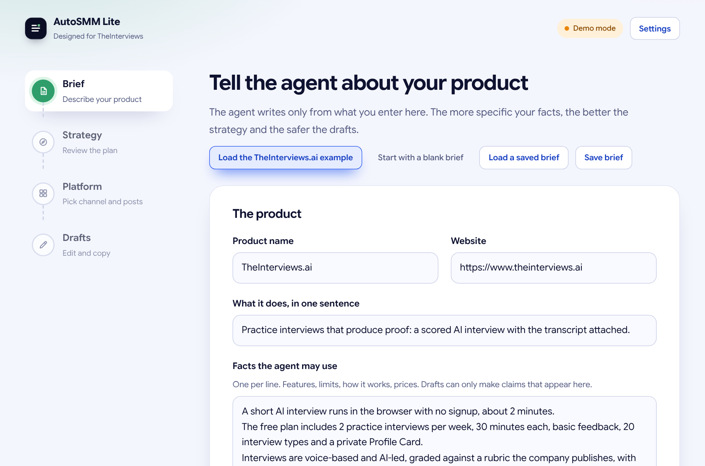
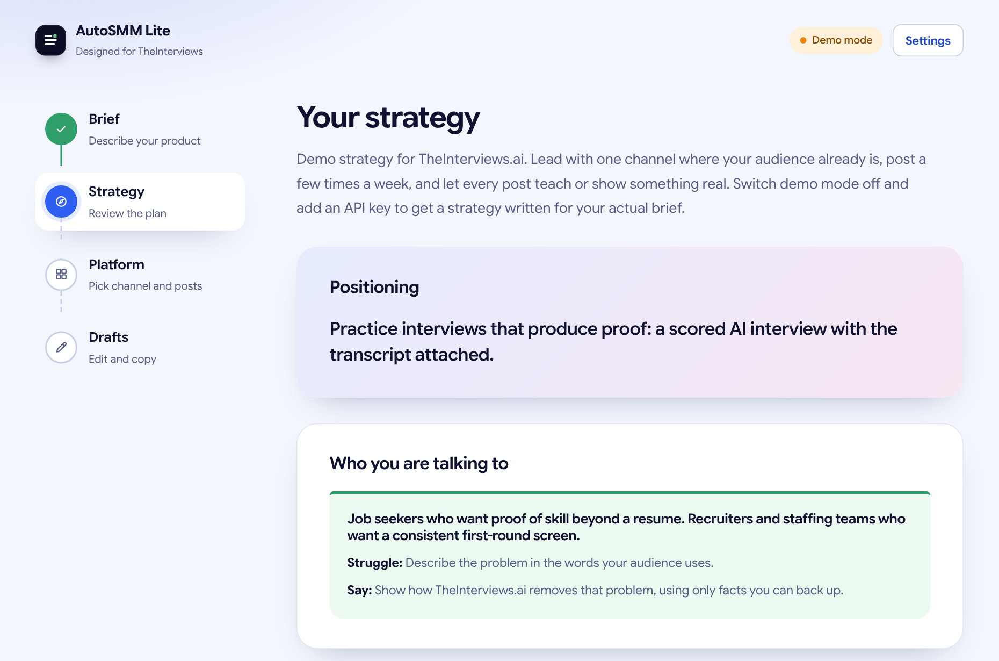

# AutoSMM Lite

**Designed for TheInterviews**

A social media agent for TheInterviews.ai. Tell it about the product once, and it plans the strategy and writes the posts for LinkedIn, Instagram, X, Facebook, YouTube, TikTok and Reddit.

 

> [!IMPORTANT]
> **It never posts for you.** You edit each draft, copy it, and publish it yourself.

  
  

## Download

- [Windows installer](https://github.com/heyshantanugupta/autosmm-lite-updates/releases/download/v1.0.0/AutoSMM-Lite-Setup-1.0.0-windows-x64.exe)
- [Mac, Apple chip (M1 or newer)](https://github.com/heyshantanugupta/autosmm-lite-updates/releases/download/v1.0.0/AutoSMM-Lite-1.0.0-mac-arm64.dmg)
- [Mac, Intel chip](https://github.com/heyshantanugupta/autosmm-lite-updates/releases/download/v1.0.0/AutoSMM-Lite-1.0.0-mac-x64.dmg)

All versions are on the [Releases page](https://github.com/heyshantanugupta/autosmm-lite-updates/releases).

The apps are not code signed yet, so the first launch shows a warning.

- **Windows:** choose "More info", then "Run anyway".
- **Mac:** open System Settings > Privacy & Security and click "Open Anyway". Or run `xattr -cr "/Applications/AutoSMM Lite.app"` in Terminal once.

## What it does

- **Builds the strategy:** positioning, audiences, content themes, which platforms to use, a weekly rhythm and what to measure.
- **Writes the posts:** drafts for LinkedIn, Instagram, X, Facebook, YouTube, TikTok and Reddit, using only the facts you give it.
- **Checks every draft:** flags claims and numbers that are not in your facts, and phrases you told it never to say.
- **Creates images:** gives you a ready-to-paste prompt for Gemini or ChatGPT.
- **Gets you posting:** copies the post and opens the platform. Adds tracked links so you can see what brings people in.
- **Exports the plan:** download the strategy as PDF or Word.

## How to use it

1. Open the app, go to Settings and choose a model provider. Paste your own API key, or turn on Demo mode to look around without one.
2. Fill in the brief, or click "Load the TheInterviews.ai example".
3. Review the strategy, pick a platform and post types, then edit and copy your drafts.

Your key stays on your computer and is only sent to the model provider you pick.

## Updates

The app checks this page once a day. When a newer version is out, it shows a notice with a link here. It never installs anything by itself.
